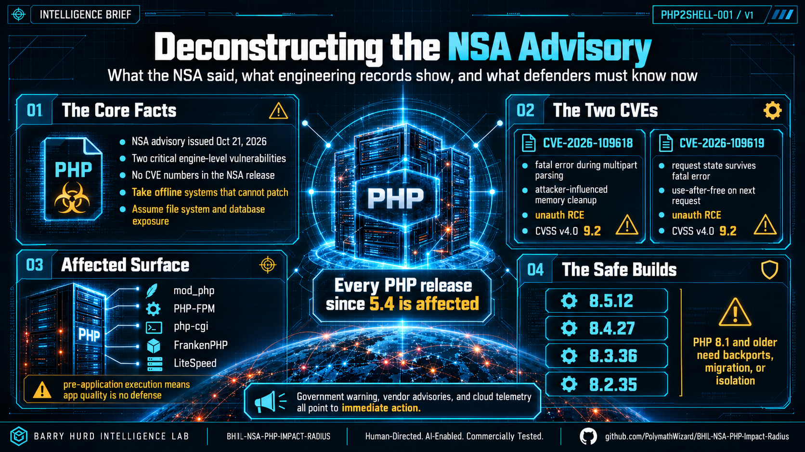

# 01 · Deconstructing the NSA Advisory

> What Fort Meade said, what it left out, and what the engineering record shows.

## The catalyst

On **October 21, 2026**, the NSA published a five-sentence press release, *NSA Advisory: PHP
Updates*. It names no CVE, no version, and no adversary. It tells every organization running
PHP to prepare for an update addressing "two critical vulnerabilities" that "often provide a
direct path to the server's file system or database," and - if updating is not feasible - to
**take the system offline** until it can be fully mitigated.

The technical substance arrived the same day from the PHP project, CISA, CERT-EU, and the UK
NCSC. Researchers named the pair **PHP2Shell**.

## The two flaws

| CVE | Root cause | Class | CVSS v4.0 |
|---|---|---|---|
| **CVE-2026-109618** | `memory_limit` is enforced with a `longjmp()` abort. An out-of-memory abort can interrupt a request mid-parse (e.g. a multipart upload), leaving data half-initialized; cleanup then frees attacker-influenced memory. | CWE-824 · unauth RCE | 9.2 Critical |
| **CVE-2026-109619** | Engine state owned by one request survives its fatal error. The next request on the same worker consumes the freed state before re-initialization - a use-after-free. | CWE-824 · unauth RCE | 9.2 Critical |

CVSS vector: `AV:N/AC:H/AT:P/PR:N/UI:N/VC:H/VI:H/VA:H/SC:N/SI:N/SA:N`.

## Five findings that matter for defenders

1. **Pre-application execution.** Risk is highest for Apache mod_php, "with a demonstrated
   exploit where an unauthenticated request can trigger the attack before any application code
   runs." Every web-serving SAPI is in scope: php-fpm, mod_php, php-cgi, FrankenPHP, LiteSpeed.
2. **Application-agnostic.** The flaw is in the engine, not the app. Wiz: "even a simple
   'Hello World' application running on an affected PHP version can be vulnerable." Demonstrated
   on WordPress, Drupal, Joomla, Magento, MediaWiki, Roundcube, phpMyAdmin, Nextcloud, Laravel,
   Symfony, WHMCS.
3. **Credential leakage without RCE.** A Heartbleed-style path returns freed worker memory
   inside a `PHPSESSID` cookie - passwords, session tokens, API keys, TLS private keys - even
   if the application never calls `session_start()`.
4. **The 9.2 is a floor.** Attack complexity is rated High, the only thing holding the score
   under 10. Wiz's central finding is that frontier AI collapsed that complexity: "a single
   researcher completed in a week what previously would have taken a world-class team months."
5. **Scoring noise.** Pre-release copies circulated with a wrong 10.0; 9.4 appeared in early
   press. The authoritative CNA score for both is **9.2**.

## Exploitation status - contested, and moving

This is best read as a **leaked-before-patch vulnerability that became an n-day within hours**,
not a classic zero-day. Coordination failed twice: CVE IDs leaked Oct 20, an exploit demo
posted in error, and pre-release hardened container images gave attackers a diffable fix hours
early.

| Source | Claim (Oct 21 UTC) |
|---|---|
| Cloudflare | Attack traffic "targeting our customers" from 07:43 - before the 14:00 release. |
| Hadrian | Exploitation "at scale," mostly the session upload-progress path. |
| watchTowr | "Active exploitation attempts" against both CVEs at 14:19. |
| Patchstack | Probing only - "no hard evidence of breaches yet." |
| Huntress | Nothing observed on partner systems as of day's end. |
| CISA | "Has not observed exploitation … as of the time of publication." KEV unlisted. |
| PHP security team | "Did not identify any functional exploits at the time of release." |

**Read it honestly:** unverified vendor telemetry in motion, a confirmation lag, and no proof
of safety. No reviewed reporting names an APT. Plan for opportunistic mass exploitation first
(webshells, cryptominers, botnet loaders), with targeted ransomware and data theft following.

## Affected & fixed versions

Every PHP release since **5.4** is affected. Fixed builds:

| Branch | Status | Fixed build | Order |
|---|---|---|---|
| 8.5 | Active support | **8.5.12** | Upgrade now. |
| 8.4 | Active support | **8.4.27** | Upgrade now. |
| 8.3 | Security-only | **8.3.36** | Upgrade now. |
| 8.2 | Security-only · EOL 2026-12-31 | **8.2.35** | Upgrade now; plan the exit. |
| 8.1 · 8.0 · 7.4 | End of life | Backport only | Rebuild/LTS build; migrate. |
| 7.3 & older · 5.x | End of life | **None - ever** | Isolate or take offline; migrate. |

> Distributions and LTS vendors received patches in advance, so package numbering may differ
> from upstream - **verify distro builds against your vendor's advisory**, not the version
> string alone. The checker in [`../tools/`](../tools/) flags this case as `VERIFY WITH VENDOR`.

*Primary sources for this section: NSA, CISA, PHP project GHSA advisories, CERT-EU, Wiz,
Sansec, Tenable. See [news-and-resources.md](news-and-resources.md).*
