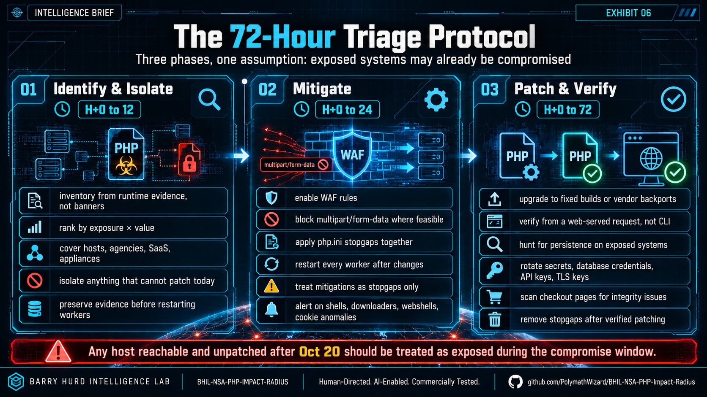

# 04 · Remediation Roadmap

> Seventy-two hours to a defensible estate. Three phases, mapped to the NSA and CISA directives.
> **Any host reachable and unpatched after October 20 is treated as potentially compromised.**

Run [`../tools/php_patch_check.py`](../tools/php_patch_check.py) against your inventory first - 
it produces the triage list Phase 1 depends on.

## Phase 1 · Identify & Isolate (H+0 - H+12)

- **Inventory from runtime evidence, not banners.** Check loaded binaries in running processes
 - web servers, containers, CI runners, cPanel/Plesk, vendor appliances, Windows software
  bundling `php-cgi.exe`. The NCSC-NL php2shell repository flags products that embed PHP.
- **Rank by exposure × value.** Internet-facing Apache mod_php first (the confirmed
  pre-application path), then checkout / payment / auth systems, then regulated data, then the
  rest. The checker's severity ordering gives you this ranking.
- **Demand written patch attestations** from hosts, agencies, SaaS vendors, appliance
  suppliers. CERT-EU: products using PHP as a backend may be affected "even if they do not
  directly expose a PHP installation."
- **Isolate what cannot patch today.** Network ACLs, VPN-only, or a static page with PHP-FPM
  stopped. Application-level maintenance modes do **not** help - PHP parses the request before
  the app checks the flag.
- **Preserve evidence on suspect hosts first** - restarting workers wipes the in-memory state
  CVE-2026-109619 abuses.

## Phase 2 · Mitigate - stopgaps only (H+0 - H+16)

Machine-readable settings in [`../data/mitigations.json`](../data/mitigations.json).

- **Edge rules on, eyes open.** Enable vendor PHP2Shell rulesets (Cloudflare live from 03:02
  UTC; Fastly, Akamai, Imperva equivalents). Cloudflare's own CTO calls them "a STOPGAP only."
- **Block the trigger class.** Every known trigger is a `multipart/form-data` request. Reject
  multipart at nginx/Apache, or allow only GET/HEAD on read-only storefronts. It breaks uploads
 - test first.
- **Apply the `php.ini` set together, then restart every worker** (pool level, not `ini_set()`):
  - `session.upload_progress.enabled=0`
  - `memory_limit=-1` via `php_admin_value`, paired with container/cgroup caps, never RLIMIT
  - a low `post_max_size`
  - on PHP 8.5, `fatal_error_backtraces=0`
- **Know the limit.** PHP: these measures "do not make an installation safe." Core developer
  Gina Peter Banyard: "the only mitigation is patching / upgrading PHP." Hours, not weeks.
- **Watch the tells** (see `mitigations.json → detection_signals`): php-fpm/httpd spawning
  shells or downloaders; multipart bursts ending in memory-limit errors; oversized `PHPSESSID`
  cookies; worker churn; new `.php` files; new cron jobs, users, or SSH keys.

## Phase 3 · Patch & Verify (H+0 - H+72)

- **Upgrade, then restart everything.** Fixed builds (8.5.12 / 8.4.27 / 8.3.36 / 8.2.35) or
  vendor backports - a patched binary on disk does not protect a running worker.
- **Verify from a web request, never CLI.** Pool and CLI configs differ. Confirm version and
  effective ini values, then close the loop with authenticated scans (Tenable, Qualys, Rapid7).
  Re-run the checker's `--local` on each host and the `--inventory` pass across the fleet.
- **Assume breach for the exposure window.** Any host reachable and unpatched after Oct 20:
  hunt webshells and persistence; **rotate** DB credentials, API keys, session secrets, and TLS
  keys (the memory-disclosure path harvests them without RCE); integrity-scan checkout pages.
- **Back out the stopgaps** once patched and verified - multipart blocks and `memory_limit=-1`
  are not permanent architecture.

## Action register

| Priority | Action | Owner | Timeframe |
|---|---|---|---|
| **P0** | Upgrade internet-facing PHP to a fixed build; restart every worker. | Platform engineering | H+0-24 |
| **P0** | Isolate or take offline every system that cannot patch (NSA directive). | Network operations | H+4-14 |
| **P1** | WAF rules, multipart blocking, `php.ini` stopgaps on everything awaiting patch. | Security operations | H+0-16 |
| **P1** | Written patch attestations from every host, agency, and vendor shipping PHP. | Third-party risk | H+4-24 |
| **P2** | Assume-breach hunt + full secret rotation for hosts exposed after Oct 20. | IR / SOC | H+24-72 |
| **P2** | Legacy migration program with recorded risk acceptances for every stay-behind. | CISO + board | Q4 2026 |
| **P3** | Fund upstream PHP security capacity (the Foundation calls the stall a structural failure). | CISO | FY 2027 |

→ Legacy systems that cannot be upgraded quickly: see [05-legacy-strategy.md](05-legacy-strategy.md).
