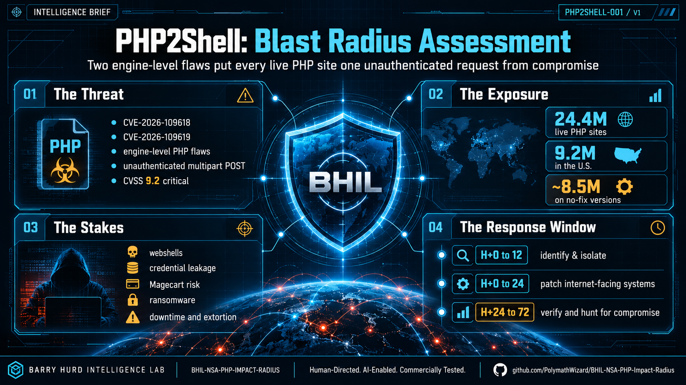
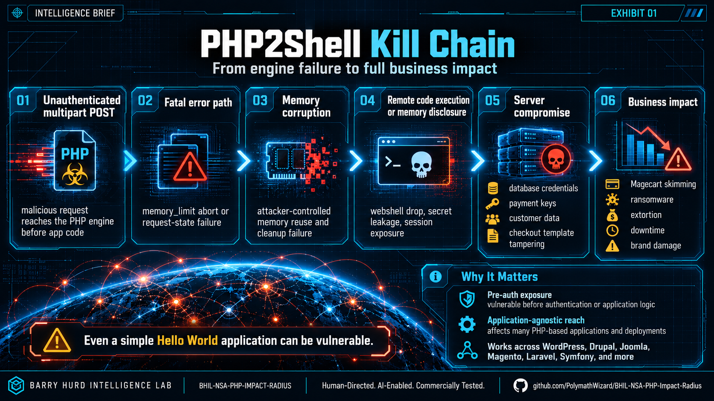
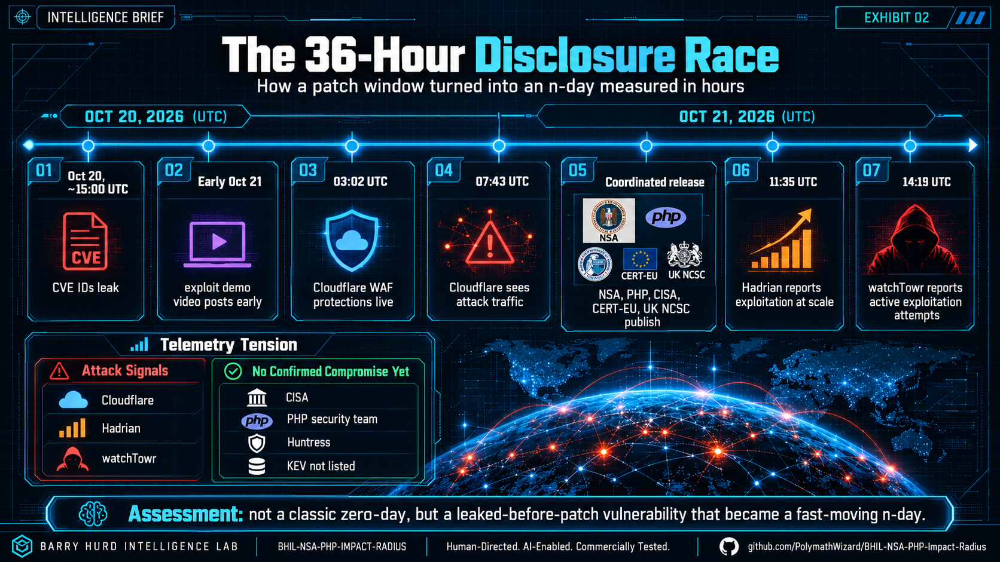
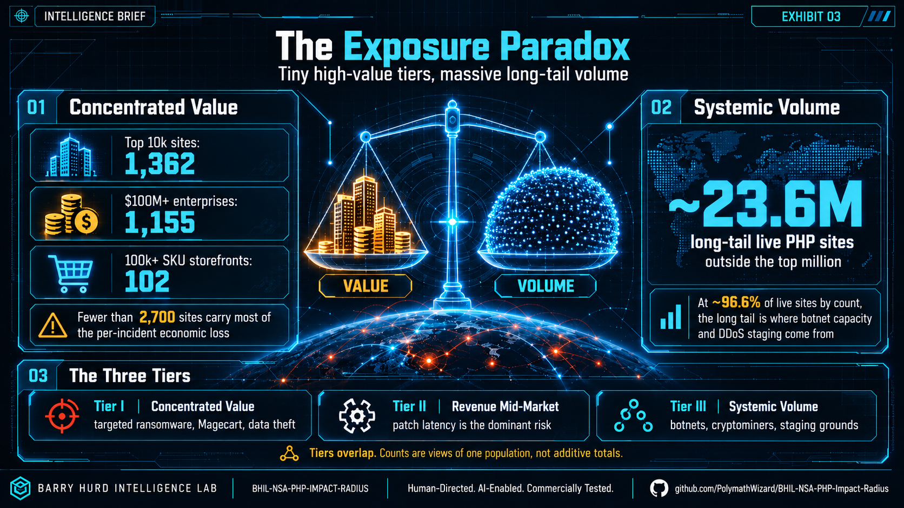
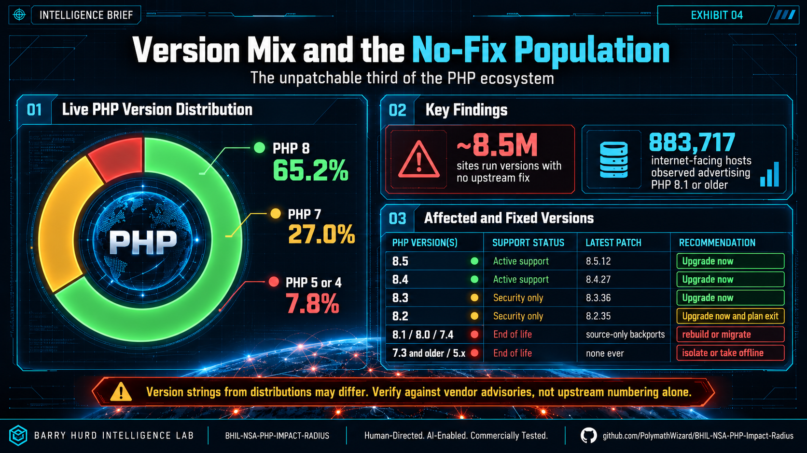
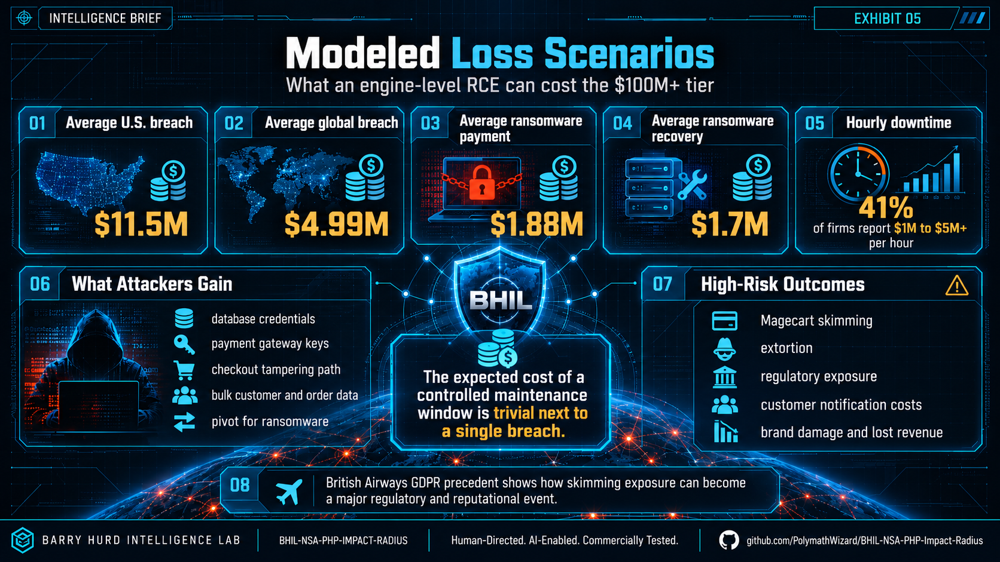
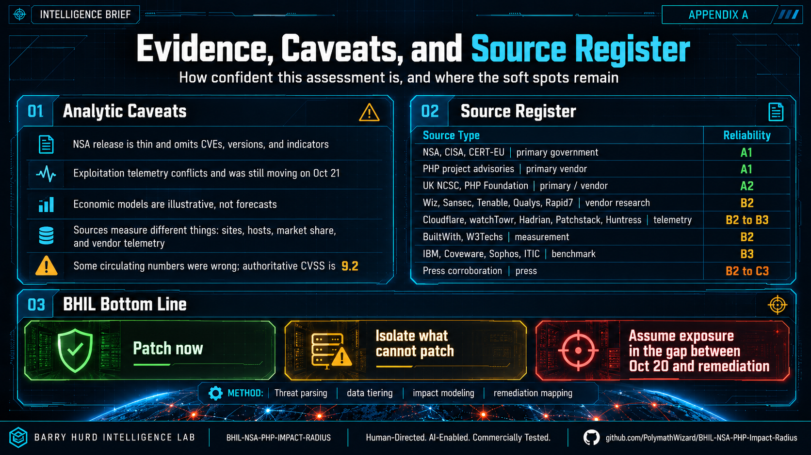

<!-- markdownlint-disable MD033 MD041 -->
# Exhibit Gallery

Eight BHIL intelligence plates from the PHP2Shell blast-radius assessment (REF PHP2SHELL-001).
Each reads on its own in about eight seconds. The living, animated version of this story is the
[scroll briefing](https://barryhurd.com/project/php2shell-blast-radius-deploy.html).

Content is licensed CC BY 4.0; reuse with attribution to Barry Hurd Intelligence Lab.

---

## Cover &middot; Blast Radius Assessment

The one-screen read: two engine-level flaws, 24.4M live sites, 9.2M in the U.S., ~8.5M on no-fix
versions, and the H+0 to H+72 response window. Full write-up:
[README](../README.md) and [docs/01](01-advisory-deconstruction.md).

## Exhibit 01 &middot; Deconstructing the NSA Advisory

What the five-sentence release said, the two CVEs side by side (both CWE-824, both CVSS 9.2), the
affected surface (every web SAPI, every release since 5.4), and the four safe builds.
&rarr; [docs/01-advisory-deconstruction.md](01-advisory-deconstruction.md)

## Exhibit 02 &middot; PHP2Shell Kill Chain

Six stages from an unauthenticated multipart POST to full business impact, with the two paths out
(remote code execution, or a no-RCE memory disclosure of secrets) and why a plain Hello World app
is still vulnerable. &rarr; [docs/01-advisory-deconstruction.md](01-advisory-deconstruction.md#vulnerability-mechanics)

## Exhibit 03 &middot; The 36-Hour Disclosure Race

A timeline of how a patch window became an n-day in hours: CVE leak, an early exploit video,
Cloudflare rules at 03:02, attack traffic at 07:43, the 14:00 coordinated release, and the
telemetry tension between attack signals and no-confirmed-compromise sources.
&rarr; [docs/01-advisory-deconstruction.md](01-advisory-deconstruction.md#exploitation-status--contested-and-moving)

## Exhibit 04 &middot; The Exposure Paradox

Value against volume: fewer than 2,700 high-tier sites carry most of the per-incident loss, while
a 23.6M-site long tail (about 96.6% by count) is the systemic risk. The three defender tiers and
the rule that tiers overlap and are never additive.
&rarr; [docs/02-exposure-matrix.md](02-exposure-matrix.md)

## Exhibit 05 &middot; Version Mix and the No-Fix Population

The live version distribution (65.2% PHP 8, 27.0% PHP 7, 7.8% PHP 5/4), the ~8.5M sites with no
upstream fix, the 883,717 hosts on PHP 8.1 or older, the full affected-and-fixed table, and the
distro-backport caveat. &rarr; [docs/02-exposure-matrix.md](02-exposure-matrix.md#the-unpatchable-third)

## Exhibit 06 &middot; Modeled Loss Scenarios

What an engine-level RCE can cost the $100M+ tier: the breach, ransomware, and downtime
benchmarks; what attackers gain; the high-risk outcomes; and the British Airways skimming
precedent. Illustrative models, not forecasts.
&rarr; [docs/03-economic-impact.md](03-economic-impact.md)

## Exhibit 07 &middot; The 72-Hour Triage Protocol

Identify and Isolate (H+0 to 12), Mitigate (H+0 to 24), Patch and Verify (H+0 to 72), under one
standing assumption: any host reachable and unpatched after October 20 is treated as exposed.
&rarr; [docs/04-remediation-roadmap.md](04-remediation-roadmap.md)

## Appendix A &middot; Evidence, Caveats, and Source Register

Where the assessment is confident and where it is soft, the Admiralty-graded source register, and
the BHIL bottom line: patch now, isolate what cannot patch, assume exposure in the gap.
&rarr; [docs/news-and-resources.md](news-and-resources.md)
